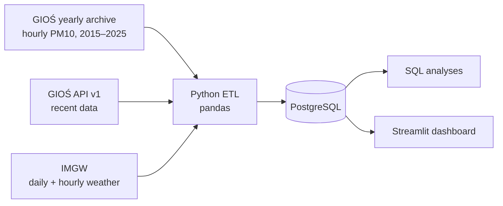

# Poland Air Quality Monitor

Did coal bans clean the air? This is my end-to-end data project on air quality in Polish cities.

> Work in progress. I'm building Stage 1 (data pipeline, SQL analysis, dashboard) in November and December 2026. See the [Roadmap](#roadmap).

## What this project is about

I want to check whether the coal heating bans in Kraków and Warsaw really improved air quality.

Since September 2019, people in Kraków can't heat their homes with coal or wood. Since October 2023, people in Warsaw can't heat with coal. The air in both cities is cleaner now than before the bans, but that alone doesn't prove the bans caused it. Winters may have been warmer or windier, and people all over Poland have been replacing old stoves, ban or no ban.

So I compare Kraków and Warsaw with Polish cities that didn't have such a ban, for example Białystok, Łódź and Gdańsk, and I take the weather into account. If smog in Kraków dropped clearly more than in the other cities under similar weather, that's an argument that the ban worked. If it dropped about as much as everywhere else, the ban didn't change much.

I look at PM10 dust from October to March, because that's when people heat their homes with stoves.

Along the way, I also answer simpler questions: which cities have the worst air, how many days a year go over the EU daily limit, and how smog depends on the weather.

## Architecture



Later I plan to add dbt warehouse layers with data-quality tests, a next-day PM10 forecast, Google Cloud (Cloud Storage, BigQuery, Cloud Run) and an LLM assistant that answers questions about the data by writing SQL.

## Data sources and licenses

| Source | What it gives me | What I use it for |
|---|---|---|
| [GIOŚ, Główny Inspektorat Ochrony Środowiska](https://powietrze.gios.gov.pl/) | the verified yearly archive of hourly measurements and station metadata | PM10 history for 2015–2025 |
| [GIOŚ API v1](https://api.gios.gov.pl/pjp-api/swagger-ui/) | current measurements, not verified yet | daily updates |
| [IMGW-PIB, Instytut Meteorologii i Gospodarki Wodnej – Państwowy Instytut Badawczy](https://danepubliczne.imgw.pl/) | daily and hourly weather from synoptic stations | weather controls |

The air-quality data come from Główny Inspektorat Ochrony Środowiska (GIOŚ). The weather data come from Instytut Meteorologii i Gospodarki Wodnej – Państwowy Instytut Badawczy (IMGW-PIB), and I processed them. I don't store raw data in this repo (see [How to run](#how-to-run)).

## Decisions about the data

### Why I only use PM10

Hourly PM2.5 isn't available consistently across cities and years:

| City (station) | Hourly PM2.5 |
|---|---|
| Kraków | stopped on 2019-12-31, so there's almost nothing after the 2019 ban |
| Białystok | only since 2025-10-24 |
| Rzeszów | none |
| Gdańsk (Wyzwolenia) | since 2021 |
| Warszawa (Tołstoja) | since 2018 |
| Łódź (Gdańska) | stopped in 2019 |

PM10 is measured every hour at all the stations I picked, and it has an EU daily limit, so all my analyses use PM10.

### How I chose cities

| Role | Cities | Why |
|---|---|---|
| Treated | Kraków, Warszawa | Kraków has banned all solid fuels (coal and wood) since 2019-09-01. Warszawa has banned hard coal since 2023-10-01, but wood is still allowed, so its ban is weaker than Kraków's. |
| Control | Białystok, Bydgoszcz, Gdańsk, Katowice, Lublin, Łódź, Olsztyn, Rzeszów, Szczecin | None of them had a city-level ban on coal or solid fuels in 2015–2026. Their regional anti-smog resolutions only set deadlines for replacing old boilers. Podlaskie (Białystok) and Warmińsko-Mazurskie (Olsztyn) have no anti-smog resolution at all. |
| Excluded | Wrocław, Poznań | Both have their own, stricter city-level resolutions, so they aren't clean controls. |

Things I keep in mind for the policy analysis:

- No control city is perfect. Most regions have boiler-replacement deadlines, and the national "Czyste Powietrze" programme runs everywhere. Katowice has some of the earliest deadlines (from 2021) and Łódź banned the oldest boilers from 2025, so I check their trends separately.
- Both bans were adopted long before they took effect. Kraków passed its resolution in 2016 and the ban started in 2019. Warsaw passed its amendment in April 2022 and the ban started in October 2023. Part of the effect may show up before the official date.
- I have nine control candidates. I'll pick the final eight once the policy analysis is set up, and Katowice is the first one I'd drop.

The sources for each regulation are in [`data/reference/policies.csv`](data/reference/policies.csv).

### How I chose stations

I kept a station only if:

1. it's an urban background station (station type: background, area type: urban), so it shows home heating rather than street traffic or industry,
2. it measures PM10 every hour,
3. according to the GIOŚ metadata, its PM10 measurement point worked from 1 January 2015 or earlier until at least 1 January 2025 (the actual gaps are listed in [Data quality](#data-quality)),
4. its series comes from that one station only. I don't glue stations together, because switching to a different station could look like a change in air quality.

I started with 19 candidate stations and kept 15. These were dropped after I checked their coverage:

| City | Station | Why it was excluded |
|---|---|---|
| Gdańsk | ul. Powstańców Warszawskich (`PmGdaPowWars`) | Hourly PM10 discontinued 2022-12-31, so no data for 2023–2026. Gdańsk is still covered by ul. Leczkowa and ul. Wyzwolenia. |
| Lublin | ul. Śliwińskiego (`LbLubSliwins`) | PM10 measured only as daily (24-hour) values, no hourly series. Lublin is still covered by ul. Obywatelska. |
| Łódź | ul. Legionów (`LdLodzLegion`) | PM10 measured only as daily (24-hour) values, no hourly series. Łódź is still covered by ul. Czernika and ul. Gdańska. |
| Warszawa | ul. Krzywoń (`MzWarAKrzywo`) | PM10 measured only as daily (24-hour) values, no hourly series. Warszawa is still covered by ul. Kondratowicza, ul. Tołstoja and ul. Wokalna. |

Some stations show up under old codes in older archive files. In my data, three stations used old codes in 2015–2021: `PmGdaLeczk08` → `PmGdaLeczkow`, `PmGdaWyzwo03` → `PmGdaWyzwole`, `ZpSzczAndr01` → `ZpSzczAndrze`. GIOŚ switched to the current codes during 2021, and the old and new codes never overlap in time. I keep all old codes in `stations.csv` (a station can have several, separated by commas) and map them to the current code while parsing.

The full list of stations, with current and old GIOŚ codes, is in [`data/reference/stations.csv`](data/reference/stations.csv).

### Weather data (IMGW)

I use one IMGW synoptic station per city, because synoptic stations measure all the variables I need (temperature, wind, precipitation, snow depth, humidity) and their data are quality-checked.

| City | IMGW station | Note |
|---|---|---|
| Białystok | Białystok | |
| Bydgoszcz | Toruń | The Bydgoszcz synoptic station has no daily data, so I use Toruń (about 40 km away) |
| Gdańsk | Gdańsk-Świbno | The only Gdańsk synoptic station with daily data |
| Katowice | Katowice-Muchowiec | |
| Kraków | Kraków-Balice | |
| Lublin | Lublin-Radawiec | |
| Łódź | Łódź | |
| Olsztyn | Olsztyn | |
| Rzeszów | Rzeszów-Jasionka | |
| Szczecin | Szczecin | |
| Warszawa | Warszawa-Okęcie | |

The station list is in [`data/reference/weather_stations.csv`](data/reference/weather_stations.csv).

Each GIOŚ station is matched to the IMGW station of its city, and the distance between them is stored in `station_weather_map`. Most distances are 3–15 km. The longer ones are Gdańsk (about 20 km, because Świbno is on the coast east of the city) and Bydgoszcz (about 40 km, because it uses Toruń). I take station coordinates from WMO station lists, given to the nearest minute (about 1–2 km), which is precise enough for these distances. Distances are great-circle distances (haversine formula).

Things I found in the IMGW data:

- IMGW stopped publishing daily wind and humidity (`s_d_t` files) after June 2024. For July 2024 – December 2025 I compute daily means from the hourly synoptic data of the same stations, using only days with at least 18 valid hours. I checked this against the official daily means for January–June 2024, when both sources exist: the mean absolute difference is 0.12 m/s for wind speed and 0.6 percentage points for humidity (Białystok, 182 days).
- From 2024 on, IMGW leaves the value empty on days without precipitation or snow cover (status 9, "no phenomenon"), while earlier years store 0. The parser sets status 9 to 0 for all years, and status 8 ("no measurement") to missing.
- Snow depth has gaps at some stations: Olsztyn has no snow data for 2015–2016 and part of 2017, and Gdańsk-Świbno has irregular snow measurements in 2023–2025 (about half of the days missing in 2024–2025). Missing snow depth stays empty rather than being set to 0.
- Toruń and Gdańsk-Świbno have no daily records for 23–24 October 2024.
- Relative humidity is capped at 100% (two days were slightly above because of rounding in the source).

### Other rules

- A daily average counts only when at least 18 hourly values (75% of the day) are there. Because timestamps mark the end of the hour, I assign each hour to the day of `ts - 1 hour`, so a day covers the values stamped 01:00 to 00:00 of the next day.
- Verified data win. Values from the GIOŚ yearly archive overwrite unverified API values for the same station and hour, but API values never overwrite archive values.
- Loading is idempotent. Data go through a staging table and an upsert on station, pollutant and timestamp, so running the load twice doesn't create duplicates. I checked this: after a second run the table still has 1,329,333 rows.
- Every load is logged in the `etl_run` table with its start and end time, status, number of rows and any error, so I can see whether the pipeline ran and how much it loaded.
- I fix problems in the source data openly, not silently. The GIOŚ metadata file has a closing date typed as `31.12.20025`. I correct it to `31.12.2025` in code instead of turning it into an empty value, because an empty closing date would make a closed measurement point look like it's still working.
- The archive layout changes between years. The header block above the data has 3 rows in 2015 and 6 rows from 2016 on, and the sixth row has a different label in some years ("Czas pomiaru" in 2016 and 2018, "Kod stanowiska" in the others). So my parser looks for the "Kod stacji" row and keeps only the rows whose first cell is a timestamp, instead of assuming a fixed number of header rows.
- Timestamps mark the end of the hour. Each year starts at 01:00 on 1 January, so the value stamped 01:00 covers 00:00–01:00, and the value stamped 00:00 on 1 January belongs to the previous year. Excel stores times with small floating-point errors (for example `03:00:00.005`), so I round timestamps to the full hour.
- The number format changes between years. In the 2016–2018 files, values are stored as text with a decimal comma (for example `"66,1195"`), while other years store them as numbers. My parser turns commas into dots before converting to numbers. Without this step, three years of data were silently dropped.
- I don't fill gaps with other stations. When a selected station has a gap, I don't replace it with another station from the same city, even if one exists (for example `KpBydPlPozna` in Bydgoszcz or `LdLodzJanPaw` in Łódź in 2022).
- I reject negative values. There were none in the verified archive, but the check stays in the pipeline for the unverified API data.

## Data quality

After parsing the GIOŚ archive (13.9 million hourly PM10 values from all Polish stations in 2015–2025), mapping old codes and filtering to my 15 stations, I have 1,329,333 hourly values. That's about 92% of all possible station-hours, or 97% if I leave out the known gaps listed below. There are no duplicate station-hours and no negative values. Most station-years have 8,100–8,780 of 8,760 hours.

Known gaps (no data under any code in the archive):

| Station | Missing period | Impact |
|---|---|---|
| Warszawa, ul. Tołstoja (`MzWarTolstoj`) | 2015–2017 | Warszawa is covered by the two other stations |
| Warszawa, ul. Kondratowicza (`MzWarKondrat`) | 2020–2023 | The gap ends just before the October 2023 ban, so the set of Warsaw stations changes around the ban date. For the Warsaw policy analysis I'll only use stations with continuous data. |
| Bydgoszcz, ul. Warszawska (`KpBydWarszaw`) | 2022 | It's the only station in Bydgoszcz, so the city has no data for 2022 |
| Łódź, ul. Gdańska (`LdLodzGdansk`) | 2022 | Łódź is covered by ul. Czernika |

The station metadata listed all of these measurement points as active the whole time. I only found the gaps by counting hours per station and year in the actual data.

After loading, I checked the database against the staging file. The number of hours per station and year matches exactly ([`sql/analysis/01_completeness.sql`](sql/analysis/01_completeness.sql)). Hourly PM10 values range from 0 to 672 µg/m³, with an average of 25 µg/m³. The maximum is high but plausible for a winter smog episode.

## Data model

The PostgreSQL schema is in [`sql/ddl/001_tables.sql`](sql/ddl/001_tables.sql).

| Table | One row is | Filled so far |
|---|---|---|
| `station` | one GIOŚ station | yes, 15 stations |
| `policy` | one city's anti-smog regulation | yes, 13 cities |
| `measurement_hourly` | one station × pollutant × hour | yes, 1,329,333 PM10 values (2015–2025) |
| `etl_run` | one pipeline run | yes |
| `sensor` | one API sensor | week 3 (API) |
| `weather_station`, `weather_daily` | one IMGW station / one station × day | yes, 11 stations and 44,194 station-days (2015–2025) |
| `station_weather_map` | one GIOŚ station mapped to a weather station | yes, 15 stations |

Measurements reference stations through a foreign key, and checks in the schema reject negative values and unknown pollutants.

Two views in [`sql/ddl/002_views.sql`](sql/ddl/002_views.sql) prepare the data for analysis:

| View | One row is | What it adds |
|---|---|---|
| `pm_daily` | one station × day | daily PM10 mean, number of hours, whether the EU daily limit (50 µg/m³) was exceeded |
| `city_daily` | one city × day | mean of the station daily means, number of stations, weather from the matched IMGW station |

The 18-hour rule drops 1,054 of 56,178 station-days (about 2%). City coverage in `city_daily` ranges from 87% of the 4,018 days in 2015–2025 (Bydgoszcz, which has no data for 2022) to over 99% (Warszawa, Łódź, Gdańsk). In Warszawa the number of stations behind the city mean changes over time (one to three), so for the ban analysis I'll use only stations with continuous data.

## Repository structure

```text
poland-air-quality/
├── data/                        # not tracked, except data/reference/
│   ├── reference/               # stations.csv, policies.csv, weather_stations.csv
│   ├── raw/gios/<year>/         # GIOŚ yearly archives (downloaded manually)
│   ├── raw/imgw/<year>/         # IMGW daily synoptic data
│   ├── raw/imgw_hourly/<year>/  # IMGW hourly synoptic data (2024–2025)
│   └── staging/                 # gios_hourly.parquet, imgw_daily.parquet
├── docs/                        # diagrams, screenshots, report
├── notebooks/                   # exploration and analysis
├── sql/
│   ├── ddl/                     # 001_tables.sql (schema), 002_views.sql (daily views)
│   └── analysis/                # analytical queries, one question per file
├── src/
│   ├── gios_archive.py          # parse the GIOŚ yearly archive into Parquet
│   ├── imgw.py                  # download and parse IMGW weather data into Parquet
│   ├── mapping.py               # match GIOŚ stations to IMGW stations and compute distances
│   └── load.py                  # load stations, policies, measurements, weather and the station mapping into PostgreSQL
├── app/                         # Streamlit dashboard
└── tests/
```

## How to run

I'll fill in this section as I build the pipeline.

```bash
git clone https://github.com/KardaszS/poland-air-quality.git
cd poland-air-quality
python3 -m venv .venv
source .venv/bin/activate
pip install -r requirements.txt
cp .env.example .env   # then set DATABASE_URL
```

I download the raw data by hand from the [GIOŚ archive](https://powietrze.gios.gov.pl/pjp/archives): one ZIP per year (2015–2025), unpacked to `data/raw/gios/<year>/`. Some archives unpack to a folder named "Wyniki pomiarów z <year> roku" instead of just the year, so rename it to `<year>`. I only use the hourly PM10 files (`<year>_PM10_1g.xlsx`). The parsed and filtered data are saved to `data/staging/gios_hourly.parquet`.

To parse the archive and build the staging file:

```bash
python -m src.gios_archive
```

To download and parse the IMGW weather data:

```bash
python -c "from src.imgw import download_synop; download_synop()"
python -c "from pathlib import Path; from src.imgw import download_synop; download_synop(years=range(2024, 2026), raw_dir=Path('data/raw/imgw_hourly'), interval='terminowe')"
python -m src.imgw
```

To create the database, load the data and create the daily views:

```bash
createdb airq
psql airq -f sql/ddl/001_tables.sql
python -m src.load
psql airq -f sql/ddl/002_views.sql
```

## Roadmap

- [x] Repo and environment setup
- [x] Station coverage check and selection (PM10)
- [x] Download and parse GIOŚ archive 2015–2025 (hourly PM10, 15 stations)
- [x] Load GIOŚ data into PostgreSQL
- [x] Load IMGW weather data
- [x] Match weather stations to air-quality stations
- [ ] SQL analyses (exceedance days, trends, seasons, weather)
- [ ] Daily load from the GIOŚ API (GitHub Actions)
- [ ] Streamlit dashboard
- [ ] Ban analysis: compare Kraków and Warsaw with control cities, taking weather into account
- [ ] Short report for non-technical readers
- [ ] dbt warehouse layers and data-quality tests
- [ ] Next-day PM10 forecast
- [ ] Deployment on Google Cloud
- [ ] LLM assistant (questions in plain language → SQL)

## Key findings

I'll add them after Stage 1, in December 2026.

## Related work

[krakow-air-quality](https://github.com/PortfolioKarolGucwa/krakow-air-quality) looks at the 2019 ban in Kraków on its own. I'm taking the question further: several cities, the 2023 ban in Warsaw too, and a comparison with cities that had no ban.

## Author

Szymon Kardasz, Computer Science student at Białystok University of Technology. [GitHub](https://github.com/KardaszS)

## License

My code is under the MIT license (see [LICENSE](LICENSE)). The data stay under the terms of their original providers, GIOŚ and IMGW-PIB.
