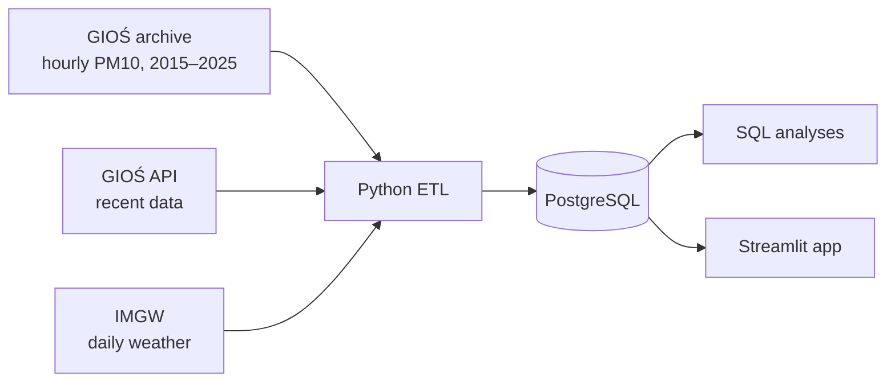

# Poland Air Quality Monitor

Work in progress. I'm building this project between November 2026 and spring 2027.

## What this is about

Kraków banned heating with coal and wood in September 2019. Warsaw banned coal heating in October 2023. I want to find out whether the air actually got better in winter because of these bans, or whether it's just milder winters and changes that happened everywhere in Poland at the same time.

To check this, I compare PM10 levels in Kraków and Warsaw with other Polish cities that didn't introduce similar bans, and I take weather into account (temperature, wind, rain). Along the way I also look at simpler things: which cities have the worst air, how many days a year go over the EU daily limit, and when smog is at its worst.

The data comes from GIOŚ (air quality) and IMGW (weather). I load it with Python into PostgreSQL, analyse it in SQL and pandas, and show the results in a Streamlit app. Later I plan to add a dbt warehouse, a next-day PM10 forecast, deployment on Google Cloud and an assistant that answers questions about the data by writing SQL.



## Data sources

| Source | What I use |
|---|---|
| [GIOŚ](https://powietrze.gios.gov.pl/) yearly archive | Verified hourly PM10, 2015–2025, and station metadata |
| [GIOŚ API v1](https://api.gios.gov.pl/pjp-api/swagger-ui/) | Recent (not yet verified) measurements |
| [IMGW-PIB](https://danepubliczne.imgw.pl/) | Daily weather data |

Air-quality data: Główny Inspektorat Ochrony Środowiska (GIOŚ). Weather data: Instytut Meteorologii i Gospodarki Wodnej – Państwowy Instytut Badawczy (IMGW-PIB), processed by me. Raw data files are not stored in this repo.

## Decisions about the data

### Why only PM10

I wanted to use PM2.5 as well, but the hourly PM2.5 series have too many gaps:

| City (station) | Hourly PM2.5 |
|---|---|
| Kraków | stopped on 2019-12-31, so there is almost nothing after the 2019 ban |
| Białystok | only since 2025-10-24 |
| Rzeszów | none |
| Gdańsk (Wyzwolenia) | since 2021 |
| Warszawa (Tołstoja) | since 2018 |
| Łódź (Gdańska) | stopped in 2019 |

PM10 is measured continuously at all the stations I picked, and there is an EU daily limit for it (50 µg/m³, no more than 35 days a year). So everything in this project is based on PM10.

### How I chose stations

I kept stations that:

1. are urban background stations, so they mostly show home heating, not traffic or industry,
2. measure PM10 every hour,
3. have measured PM10 from 1 January 2015 or earlier until at least 1 January 2025.

I also don't glue together data from different stations. If one station closes and another opens, the city average can jump just because the station changed, and that could look like the effect of a ban.

Out of 19 candidate stations I kept 15. These four were dropped:

| City | Station | Why |
|---|---|---|
| Gdańsk | ul. Powstańców Warszawy (`PmGdaPowWars`) | hourly PM10 stopped on 2022-12-31; Gdańsk still has two other stations |
| Lublin | ul. Śliwińskiego (`LbLubSliwins`) | TODO; Lublin still has other stations |
| Łódź | TODO (`TODO`) | TODO; Łódź still has other stations |
| Warszawa | TODO (`TODO`) | TODO; Warsaw still has other stations |

Some stations have several old codes (for example Gdańsk, ul. Leczkowa: `Pm.a08a`, `PmGdaLeczk08`, `PmGdaLecz08m`), because GIOŚ changed its coding more than once. I keep all old codes in `stations.csv` and map them to the current code when loading older files.

The full list of stations is in [`data/reference/stations.csv`](data/reference/stations.csv), and the anti-smog rules I checked for each city, with sources, are in [`data/reference/policies.csv`](data/reference/policies.csv).

### Other rules

- A daily average is calculated only if at least 18 hourly values are available for that day.
- Verified data from the yearly archive overwrite unverified API data for the same station and hour.
- Running the load twice doesn't create duplicates.
- I fix errors in the source data openly. For example, the GIOŚ metadata file has a closing date typed as `31.12.20025`. I correct it to `31.12.2025` in the code instead of turning it into an empty value, because an empty closing date would make a closed station look like it's still working.

## How to run

This section will grow as the pipeline gets built.

Raw data are downloaded by hand from the [GIOŚ archive](https://powietrze.gios.gov.pl/pjp/archives): one ZIP per year (2015–2025), unpacked to `data/raw/gios/<year>/`. Some archives unpack to a folder called "Wyniki pomiarów z <year> roku", so rename it to just `<year>`. I only use the hourly PM10 files (`<year>_PM10_1g.xlsx`).

```bash
git clone https://github.com/KardaszS/poland-air-quality.git
cd poland-air-quality
python3 -m venv .venv
source .venv/bin/activate
pip install -r requirements.txt
cp .env.example .env   # then set DATABASE_URL
```

## Progress

- [x] Repo and environment setup
- [x] Station coverage check and selection (PM10)
- [x] Download the GIOŚ yearly archive 2015–2025
- [ ] Load the archive into PostgreSQL
- [ ] Load IMGW weather data and match weather stations to air-quality stations
- [ ] SQL analyses: limit exceedances, trends, seasons, weather
- [ ] Daily update from the GIOŚ API (GitHub Actions)
- [ ] Streamlit app
- [ ] Comparing Kraków and Warsaw with the other cities, taking weather into account
- [ ] Short report for non-technical readers
- [ ] dbt models and data tests
- [ ] Next-day PM10 forecast
- [ ] Google Cloud deployment
- [ ] Assistant that answers questions about the data using SQL

## Results

Coming in December 2026.

## Related project

[krakow-air-quality](https://github.com/PortfolioKarolGucwa/krakow-air-quality) looks at the 2019 ban in Kraków only. I wanted to go further: compare several cities, include the 2023 ban in Warsaw, and check the results against cities without bans.

## About me

Szymon Kardasz, Computer Science student at Białystok University of Technology. [GitHub](https://github.com/KardaszS)

## License

The code is under the MIT license (see [LICENSE](LICENSE)). The data stay under the terms of GIOŚ and IMGW-PIB.
