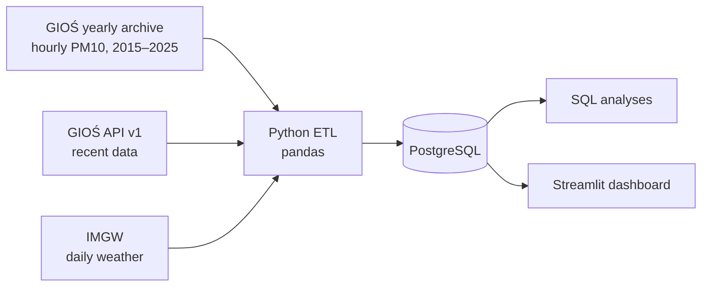

# Poland Air Quality Monitor

**Did coal bans clean the air? An end-to-end data project on air quality in Polish cities.**

> **Work in progress.** Stage 1 (data pipeline, SQL analysis, dashboard) is being built in November–December 2026. See [Roadmap](#roadmap).

## The question

Kraków banned solid-fuel heating (coal and wood) on **1 September 2019**. Warsaw banned coal heating on **1 October 2023**.

**Did these bans measurably improve winter air quality once weather and nationwide trends are taken into account?**

To answer this, the project compares PM10 levels in the two cities with the bans against Polish cities without comparable bans over the same period, controlling for weather (temperature, wind, precipitation).

Supporting questions:

- Which cities have the worst air quality, and how has this changed since 2015?
- How many days per year exceed the EU daily PM10 limit (50 µg/m³, max. 35 days/year)?
- How strongly does smog depend on weather?
- When is pollution worst (month, weekday, hour)?
- How do Polish cities compare with the WHO 2021 guideline (45 µg/m³ daily PM10)?

## Architecture



Planned extensions: dbt warehouse layers with data-quality tests, a next-day PM10 forecast, Google Cloud (Cloud Storage, BigQuery, Cloud Run) and an LLM assistant that answers questions about the data via SQL.

## Data sources & licenses

| Source | Data | Use |
|---|---|---|
| [GIOŚ – Chief Inspectorate of Environmental Protection](https://powietrze.gios.gov.pl/) | Verified yearly archive of hourly measurements; station metadata | Historical PM10 (2015–2025) |
| [GIOŚ API v1](https://api.gios.gov.pl/pjp-api/swagger-ui/) | Current (unverified) measurements | Daily incremental updates |
| [IMGW-PIB – Institute of Meteorology and Water Management](https://danepubliczne.imgw.pl/) | Daily synoptic weather data | Weather controls |

Source of air-quality data: Główny Inspektorat Ochrony Środowiska (GIOŚ). Source of weather data: Instytut Meteorologii i Gospodarki Wodnej – Państwowy Instytut Badawczy (IMGW-PIB); the data have been processed. Raw data are not stored in this repository (see [How to run](#how-to-run)).

## Data processing decisions

### Pollutant scope: PM10 only

Hourly PM2.5 series are not available consistently across cities and periods:

| City (station) | Hourly PM2.5 availability |
|---|---|
| Kraków | discontinued 2019-12-31, so almost no data after the 2019 ban |
| Białystok | only from 2025-10-24 |
| Rzeszów | no hourly PM2.5 |
| Gdańsk (Wyzwolenia) | from 2021 |
| Warszawa (Tołstoja) | from 2018 |
| Łódź (Gdańska) | discontinued in 2019 |

PM10 has continuous hourly coverage at the selected stations and an EU daily limit value, so **all analyses use PM10**.

### Station selection

Criteria:

1. Urban background station (station type: background, area type: urban), so that measurements reflect residential heating rather than street traffic or industry.
2. PM10 measured with a 1-hour averaging time.
3. The PM10 measurement point operated from 2015-01-01 or earlier until at least 2025-01-01.
4. No splicing: each series comes from a single station. A change of station could look like a change in air quality.

Stations excluded after the coverage check (19 candidate stations, 15 selected):

| City | Station | Reason |
|---|---|---|
| Gdańsk | ul. Powstańców Warszawy (`PmGdaPowWars`) | Hourly PM10 discontinued 2022-12-31, so no data for 2023–2026. Gdańsk is covered by two other stations. |
| Lublin | ul. Śliwińskiego (`LbLubSliwins`) | TODO: reason (daily-only PM10 or incomplete hourly coverage). Lublin is covered by other stations. |
| Łódź | TODO: name (`TODO`) | TODO: reason. Łódź is covered by other stations. |
| Warszawa | TODO: name (`TODO`) | TODO: reason. Warszawa is covered by other stations. |

The final list of stations (with current and legacy GIOŚ codes) is in [`data/reference/stations.csv`](data/reference/stations.csv). The anti-smog regulations considered for each city, with sources, are in [`data/reference/policies.csv`](data/reference/policies.csv).

### Other rules

- **Daily means** are computed only when at least 18 valid hourly values (75% of the day) are available.
- **Verified data take priority:** values from the GIOŚ yearly archive overwrite unverified values from the API for the same station and hour.
- **Loads are idempotent:** re-running the pipeline does not create duplicates (upsert on station, pollutant and timestamp).

## Repository structure

```text
poland-air-quality/
├── data/                  # not tracked, except data/reference/
│   └── reference/         # stations.csv, policies.csv
├── docs/                  # diagrams, screenshots, report
├── notebooks/             # exploration and analysis
├── sql/
│   ├── ddl/               # table and view definitions
│   └── analysis/          # analytical queries, one question per file
├── src/                   # ETL code (GIOŚ archive, GIOŚ API, IMGW, loading)
├── app/                   # Streamlit dashboard
└── tests/
```

## How to run

> Setup instructions will be completed as the pipeline is built.

```bash
git clone https://github.com/KardaszS/poland-air-quality.git
cd poland-air-quality
python3 -m venv .venv
source .venv/bin/activate
pip install -r requirements.txt
cp .env.example .env   # then set DATABASE_URL
```

## Roadmap

- [x] Repository and environment setup
- [x] Station coverage analysis and selection (PM10)
- [ ] Load GIOŚ archive 2015–2025 into PostgreSQL
- [ ] Load IMGW weather data and map weather stations to air-quality stations
- [ ] SQL analyses (exceedance days, trends, seasonal and weather patterns)
- [ ] Daily incremental load from the GIOŚ API (GitHub Actions)
- [ ] Streamlit dashboard
- [ ] Policy analysis: weather-adjusted comparison of Kraków and Warszawa with control cities
- [ ] Short report for non-technical readers
- [ ] dbt warehouse layers and data-quality tests
- [ ] Next-day PM10 forecast
- [ ] Deployment on Google Cloud
- [ ] LLM assistant (natural-language questions → SQL)

## Key findings

To be added after Stage 1 (December 2026).

## Related work

[krakow-air-quality](https://github.com/PortfolioKarolGucwa/krakow-air-quality) analyses the 2019 Kraków ban for Kraków alone. This project extends the question to several cities, adds the 2023 Warsaw ban, and compares the cities with bans against control cities.

## Author

Szymon Kardasz – Computer Science student, Białystok University of Technology
[GitHub](https://github.com/KardaszS)

## License

Code: MIT (see [LICENSE](LICENSE)). Data remain subject to the terms of their original providers (GIOŚ, IMGW-PIB).
